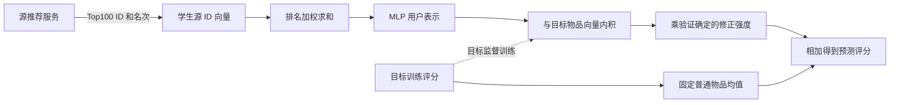

# 当前 LIST：研究定位、工作流与文献撞车检查

核查日期：2026-09-23。依据当前代码、Slurm 8650/8651 的冻结产物，以及公开论文正文和作者资料。本次没有启动训练或修改实验实现。

**当前主版本是：DNN 源 Top100 ID/排名 → 排名加权列表编码 → 固定普通目标物品均值上的残差修正。** 频次降权和目标相关加权暂作为消融；它们没有一致改善主版本。

**初步判断：实验已经支持这个受限接口有用；网络组件和残差思路已有明显先例。检索范围内尚未确认一篇与全部接口条件、训练任务及工作流完全相同的论文，但这不是“首次提出”的证明。**

## 1. 研究问题

一个用户在音乐平台已有使用记录，但刚进入电影平台，还没有电影评分。如果音乐平台只给电影平台一份 Top-K 推荐列表，不提供听歌记录、真实评分、预测分数、模型参数或内部用户向量，电影平台能否仅凭列表中的物品 ID 和名次，更准确地预测该用户会给电影打多少分？

进一步问：列表提供的信号能否超过目标域本来就知道的物品平均评分？这种改善是否依赖“这份列表确实属于这个用户”？

这一问题包括三个可检验部分：

| 问题 | 对应比较 | 当前证据 |
| --- | --- | --- |
| 源列表是否提供目标域增量？ | 真实 LIST vs 普通物品均值 | 当前去重 Music→Movie 两档均改善 MAE/RMSE |
| 增量是否依赖用户与列表的对应？ | 真实列表 vs 固定错配列表，分别完整训练 | 当前两档均改善；支持存在用户相关信号 |
| 如何可靠利用这些增量？ | 原 LIST vs 固定均值残差版及加权消融 | 残差版改善；复杂加权没有一致收益 |

“用户相关信号”可能包含兴趣、评分尺度、活跃程度等。现有结果不能把它完全解释为精细的跨品类语义兴趣，也不能证明实际线上点击或排序效果已经提高。

## 2. 设定与 gap

| 要素 | 当前 LIST 的实际条件 |
| --- | --- |
| 源信息接口 | 每个用户一份源 Top100，学生只读 ID 和排名 |
| 源端内部信息 | 学生不读真实交互、评分、返回分数、参数、梯度、教师向量或物品文本 |
| 用户关联 | 已知跨域用户身份对应；训练时有重叠用户及其目标评分 |
| 目标测试用户 | 无目标训练历史，有自己的源列表；“目标冷”不等于“源域也冷” |
| 物品关联 | 源、目标目录去重，不依赖共享物品；目标物品通常在目标训练中出现 |
| 监督信号 | 目标训练集真实评分，不是源教师的分数或排序模仿损失 |
| 验证与评价 | 按目标用户隔离；验证 RMSE 选模；最终报告 MAE/RMSE |

可以成立的 **接口 gap** 是：已有方法能够访问的数据或模型能力，往往比一个仅返回 ID/名次的源服务更丰富。EMCDR 迁移内部用户向量；PFCDR 虽不直接传输原始历史，其源端仍执行模型反演并提供原型，需要服务端配合和内部能力。因此 PFCDR 不能在“仅给列表、不能新增原型接口”的约束下原样执行。参见 [EMCDR，IJCAI 2017](https://www.ijcai.org/Proceedings/2017/0343.pdf)、[PFCDR 论文](https://doi.org/10.1145/3696410.3714580)及[作者代码](https://github.com/walcheng/PFCDR)。

可以成立的 **实验问题** 是：需要把目标物品本身的评分水平，与源列表带来的额外预测能力分开评估。但“先建模偏置，再学习个性化”本来就是推荐系统的经典做法，不能写成文献从未考虑过的 gap。我们当前的贡献候选，是在这个受限接口下给出干净、可复核的增量证据。

不宜写成“现有 CDR 都需要共享原始数据”或“现有方法都忽略负迁移”。已有隐私友好、蒸馏、门控和残差研究涉及这些问题。本轮 MF 基线偏弱，也不能证明 EMCDR/PFCDR 的调参性能上限低于 LIST。

## 3. 主要思想与具体工作流

把源推荐列表视为源服务对用户的一个可观察画像，用目标训练评分学习如何解读它。目标物品的普遍评分水平先固定下来；列表模型只负责学习这个用户可能偏高或偏低多少。

原 LIST 已经包含“全局训练均值＋可训练物品偏置＋列表交互”，并非完全没有基底。本次改变是用直接统计的、固定的普通物品均值替换那部分可训练基底，同时加入零修正初始化与验证选择的修正强度。

对用户 u 的源列表 L_u=[j_1,...,j_100]，当前模型为：

\[
q_r=1/\log_2(r+1),\qquad a_r=q_r/\sum_{s=1}^{100}q_s,
\]
\[
h_u=\sum_{r=1}^{100}a_r e_{j_r},\qquad z_u=\operatorname{MLP}(h_u),
\]
\[
\hat y_{ui}=\bar y_i^{\mathrm{train}}+\lambda z_u^\top v_i.
\]

e_j 和 v_i 都是学生自己训练的 32 维参数，不是从源模型取出的向量。MLP 为 32→64→32，含 ReLU 和 dropout 0.1。排名靠前的条目初始权重更大，具体 ID 的含义由目标监督学习。不同源 ID 不需要有可读语义，也不需要和目标 ID 对齐；但同一个源 ID 必须跨用户保持一致。

例如某电影训练均值是 4.0，列表分支输出 -0.4，验证选择 λ=0.5，则预测为 3.8。没有可靠增量时，候选 λ=0 允许选择普通均值。**这只是验证选项，不是测试不退化的数学保证。**

1. **准备数据及用户划分。** 当前 Music→Movie 从源 Music 删除 2,441 个共享物品及 34,881 条评分，保留 17,904 个重叠用户。目标训练和测试用户隔离，目标训练中再留出冷用户验证集。
2. **模拟源服务并导出列表。** 实验侧用作者 DNN 源模型生成 Top100；随后学生仅使用导出的 ID/排名。当前源模型的 DNN 名称沿用作者代码，实际是用户仿射变换后与物品向量内积，不能宣传为深层非线性源网络。源模型使用源数据，包括目标测试用户合法可用的源记录。Top100 当前不排除用户已交互源物品，也没有真实线上 API 实验。
3. **计算固定基底。** 对当前阶段的目标训练评分逐物品求普通均值，不做平滑。内层选模用内层训练均值；最终重训用全部外层训练均值。未见目标物品回退训练全局均值。
4. **训练列表修正。** 编码器最后一层零初始化，初始输出恰好等于均值；关闭额外可训练物品偏置。训练时 λ=1，用目标评分 MSE 学习修正。无源列表用户修正为零；这些用户的评分仍参与基底统计，但不直接提供列表个性化监督。Adam lr=0.001、weight_decay=1e-5、batch=2048，最多 10 轮。
5. **验证确定强度与轮数。** 联合选择 epoch 0–10 和 λ∈{0,0.25,0.5,0.75,1}，以验证 RMSE 最小为准。然后相同初始化重新训练全部外层训练数据，轮数及 λ 固定。
6. **冻结后测试及错配对照。** 所有新模型冻结后统一评价。对照在 inner_train、validation、test 三组内部固定错配用户列表，并从相同初始化完整训练；不会只在真实模型测试时突然换错列表。报告三个模型种子及配对用户簇区间。

当前 ID 词表由已查询用户的全部返回 ID 建立，包含验证/测试用户的无标签列表；目标标签不参与这个步骤。因而这是固定查询快照实验，还没有证明部署后全新源 ID、不断变化的服务列表和严格在线词表的适应能力。未做时间先后划分，不能称为前瞻时序测试。

代码依据：[ResidualList](../scripts/small_task_comparison.py:281)、[列表编码器](../scripts/list_source_backbones.py:43)、[冻结协议与实验设置](small_task_comparison.md)。

## 4. 当前结果支持到什么程度

Music→Movie 去重版；β 为重叠用户中冷启动测试比例，数值越低越好。三个模型种子的指标均值，不是预测集成。

| 方法 | β20% MAE | β20% RMSE | β80% MAE | β80% RMSE |
| --- | ---: | ---: | ---: | ---: |
| 普通物品均值 | 0.828612 | 1.074618 | 0.840744 | 1.097641 |
| 原 LIST（DNN 源列表） | 0.822822 | 1.067575 | 0.870605 | 1.124753 |
| 当前 LIST：均值＋排名列表修正 | 0.808497 | 1.056126 | 0.833717 | 1.089396 |
| 同结构、错配用户列表 | 0.826968 | 1.073404 | 0.840470 | 1.097543 |
| 修正＋频次降权 | 0.808067 | 1.058466 | 0.833007 | 1.089006 |
| 修正＋目标相关加权 | 0.814642 | 1.056793 | 0.833733 | 1.090879 |

当前主版本相对均值的 RMSE 分别下降约 1.72% 和 0.75%。真实列表相对均值、原 LIST、错配列表的 MAE/RMSE 差异，其配对用户簇区间都在改善方向。错配列表也有少量改善，说明部分收益可能属于共同校准；真实与错配之间的差异才是更直接的用户对应信号证据。

当前主版本并非所有指标最优：β80% 时 EMCDR-DNN 的 MAE 为 0.826689，低于当前 LIST 的 0.833717。两种加权没有跨两档一致改善，因此暂不纳入主方法的必要模块。

这轮新主版本的完整验证只覆盖一个去重方向、两个比例、三个模型种子和一个固定用户划分。历史测试曾用于探索；本轮选模虽不读取测试标签，但不能称为全新盲测。区间条件于已训练模型及固定划分，未校正多重比较。均值替换、零初始化和修正强度选择同时改变，尚不能将收益唯一归因于其中一项。

结果依据：[8650 报告](../runs/small_task_comparison_8650/report.md)、[8651 综合报告](../runs/list_weighting_8651/report.md)。

## 5. 文献撞车检查

检索围绕 black-box/list-only/output-only cross-domain recommendation、recommendation-list transfer、ranking distillation、source-free recommendation、residual recommendation，以及相关中文术语展开。优先核对论文正文、作者 PDF、正式会议页面和官方代码；搜索聚合摘要只用于发现线索。以下风险指“若把相应宽泛思想写成原创贡献，会被已有工作覆盖”的风险，不代表已经找到完全相同的方法。

| 工作及年份 | 已有部分与我们的重叠 | 关键区别与判断 |
| --- | --- | --- |
| [Asymmetric-SVD / SVD++，KDD 2008](https://www.cs.cornell.edu/courses/cs6241/2020sp/readings/Koren-2008-Factorization.pdf)，§4、Eq.13/15 | 偏置基底、物品向量聚合、个性化内积 | 使用实际反馈；LIST 输入外域服务输出。**基底＋聚合交互的结构新颖性风险高。** |
| [FISM，KDD 2013](https://www.researchgate.net/publication/262219034_FISM_factored_item_similarity_models_for_top-N_recommender_systems)，作者上传全文 Eq.5/7 | 聚合一组物品的向量，再与候选物品向量内积；含偏置 | FISM 用历史交互，LIST 用外域推荐列表及固定均值。**最应补充的结构相近基线。** |
| [Deep Sets，NeurIPS 2017](https://arxiv.org/abs/1703.06114) | 聚合条目表示，再由网络变换 | LIST 还输入排名权重，不是单纯无序集合。**求和池化＋MLP 不能单独算创新。** |
| [Ranking Distillation，KDD 2018](https://jiaxit.github.io/resources/kdd18ranking.pdf)，§3、Eq.4/5 | 教师 Top-K 及排名权重提供学习信息 | RD 在同一候选空间学习教师偏好；LIST 把源列表当输入，用另一物品空间的目标评分监督。**列表传知识这一宽泛说法已被覆盖。** |
| [黑盒序列推荐模型提取，RecSys 2021](https://arxiv.org/pdf/2109.01165)，§3.2/4.1 | 无教师权重，仅从截断排名列表学习 | 目标为复制同域模型并攻击；LIST 直接预测另一域。**仅 ID/排名的黑盒接口不是新概念。** |
| [DBGRME，NeurIPS 2025](https://proceedings.neurips.cc/paper_files/paper/2025/file/cce7576bf51b6a156346156c0976e7f6-Paper-Conference.pdf)，§2/3 | 数据不可见时查询推荐服务并训练学生 | 使用生成查询与替代模型，优化对原模型的模仿；LIST 用重叠用户目标监督，无提取阶段。**同属黑盒输出学习，任务不同。** |
| [NATR，WWW 2019](https://fi.ee.tsinghua.edu.cn/public/publications/20f4c6da-92c4-11eb-96bc-0242ac120003.pdf)，§2.2/3 | 不共享原始用户行为也能迁移推荐信息 | 传递桥接物品向量并依赖共享物品；LIST 不接收教师向量，目录已去重。**不能声称首次减少跨域原始数据共享。** |
| [PFCDR，WWW 2025](https://doi.org/10.1145/3696410.3714580)，§4；[官方代码](https://github.com/walcheng/PFCDR) | 数据不可直接共享时的目标冷用户迁移 | 源端反演原型，不是仅列表接口；LIST 直接目标监督，不做反演与原型投票。**问题动机接近，接口和机制不同。** |
| [DeCoCDR，SIGIR 2024](https://zhouzimu.github.io/paper/sigir24-li.pdf)，§3、Figure 2 | 列表及位置反馈连接不可直接共享的跨域信息 | 云端候选在设备端利用本地跨域原始数据重排，再反馈同一候选空间；不同于音乐 ID 列表直接预测电影评分。**对“通过列表实现跨域迁移”的宽泛贡献存在实质重叠。** |
| [Zero-shot Cross-domain KD: YouTube Music，RecSys 2025](https://arxiv.org/pdf/2603.28994)，§2 | 利用既有源教师输出提升目标域 | 在音乐样本上调用视频教师获得软标签/多任务 logits；不是纯 ID 排名接口。arXiv 于 2026-03 上传，会议年份为 2025。**跨域输出迁移已有先例。** |
| [PRL，RecSys 2026 已接收，2026-07 预印本](https://arxiv.org/html/2607.20863v1)，§2.1/2.2 | 固定基础预测，只学习残差，用于跨域适配 | 使用概率用户聚类、物品特征和域混杂建模；未采用我们的源 Top-K ID 条件。**“固定基底＋跨域残差”已有直接先例，是本次最需新增讨论的工作。** |
| [DIN，KDD 2018](https://arxiv.org/abs/1706.06978)及[NAIS，TKDE 2018](https://hexiangnan.github.io/papers/tkde18-neural-attentive-itemCF.pdf) | 根据目标物品调整用户历史条目的权重 | LIST 加权 B 换为源服务列表并用余弦简化。**目标相关加权本身已有明确先例；本轮结果也未支持其作为主贡献。** |

CopyAttack 一类文献的 “black-box cross-domain” 指复制跨域用户资料来攻击目标推荐器，并不是本项目的跨域评分任务；参见[作者论文](https://arxiv.org/abs/2005.08147)。同样，不应把讨论“模型难解释”的 black-box 论文误认成严格 API 信息访问约束。

## 6. 对撞车风险的具体判断

**组件层面重叠明显，完整设定层面尚未确认完全同构工作。** 最危险的论文写法是把“Top-K 编码＋MLP＋残差”直接称为全新的跨域推荐架构。审稿人完全可能将它概括为“把 FISM 的交互集合替换成服务返回列表，再加一个固定均值”。这是一条有技术依据的质疑，需要同接口基线实验回答。

一个更稳妥的贡献表述是：

> 我们研究仅能访问源推荐服务 Top-K 物品 ID 与名次的跨域冷用户评分预测。在已知用户对应、无共享物品、无源历史和模型内部信息的条件下，将列表作为用户表示输入，以固定目标物品均值为基底学习经验证集收缩的残差。去重数据上的真实/错配列表对照表明，该接口保留了目标域可利用的用户相关信息。

这段话描述当前实现及证据，没有保证“首次”“隐私安全”“无重叠用户”“优于所有方法”或“对所有任务有效”。LIST 是直接目标监督的列表条件模型，不宜仅因叫学生模型就称为一种新的排序蒸馏损失。跨域可用信号的发现也不等于已确认其具体语义机制。

## 7. 最能增强论文说服力的后续验证

这些是后续建议，本次未启动。

1. **补同接口的简单强基线。** 用完全相同列表、均值及验证规则运行 FISM 风格线性聚合/低秩回归，及基于列表相似度的邻居残差。它们不读取源历史或教师向量。FISM 在这里属于适配到该接口的基线，不能冒称原始算法在原任务的直接复现。重点回答 MLP 和当前设计是否超过常规特征回归。
2. **分离校准与兴趣。** 比较“均值＋由列表预测的用户标量偏移”与“均值＋用户×物品残差”，并分别消融固定均值、零初始化和 λ 收缩。检验究竟学到一般打分偏好还是与目标物品有关的差异。
3. **确认列表接口的必要性和稳健性。** 原排名 vs 同用户内部乱序/均匀池化，K=10/20/50/100，源模型变化；这与此前“整份列表错配用户”的对照不同。若声称真实服务可用，还需要已交互物品过滤、训练后新 ID、列表变化等测试。
4. **扩展当前主版本的独立证据。** 其他去重方向、全新固定划分或时间划分；若论文目标为 Top-N 推荐，再增加合理的 Recall/NDCG 排序评价。新测试事先冻结方案，避免继续在同一历史测试上反复选择版本。

本次检查属于有针对性的公开文献核查，不是穷尽全部数据库和未公开稿件的系统综述；未发现完全相同论文不能证明绝对新颖性。最值得继续发展的部分，是严格源接口下“哪些信息仍能迁移、何时值得迁移”的问题与证据，算法原创性仍需要更接近的基线和独立验证支撑。
